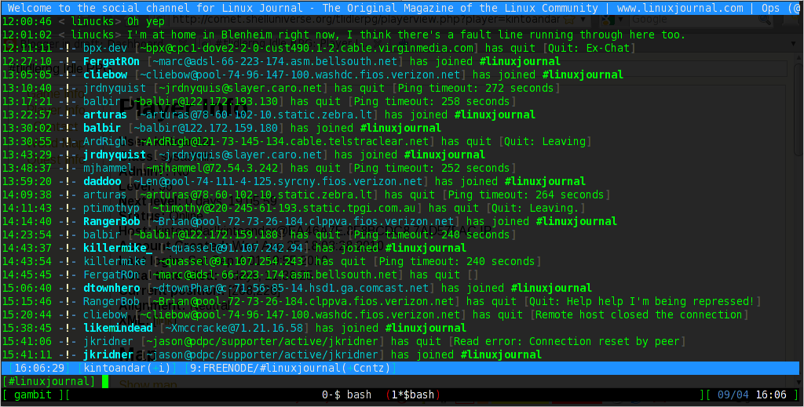

[Screen](http://www.gnu.org/software/screen/) is one of the most helpful applications you'll ever use.

This post will show the configuration I personally use and how to startup multiple applications on boot.

Here's how my config looks like running irssi:

<figure class="gallery">
  <a href="/images/screen_session.png"></a>
  <figcaption>Screen screenshot (pun intended)</figcaption>
</figure>

## Configuration
The configuration being used:

```bash
user@gambit:~$ cat ~/.screenrc
```

```bash
nethack on
defscrollback 10000
hardstatus on
hardstatus alwayslastline
hardstatus string '%{= kG}[ %{G}%H %{g}][%= %{= kw}%?%-Lw%?%{r}(%{W}%n*%f%t%?(%u)%?%{r})%{w}%?%+Lw%?%?%= %{g}][%{B} %m/%d %{W}%c %{g}]'
startup_message off
vbell on

# The applications you want running when screen starts
screen -t DOWNLOADS 0 rtorrent
screen -t IRC 1 irssi
```

## Startup
After configuring your own `.screenrc` just add on `/etc/rc.local` the following:

```bash
su user -c "screen -d -m -S SomeCoolName"
```

All done, next time there is a system reboot, screen will start with two applications running in the chosen _user_ space.
