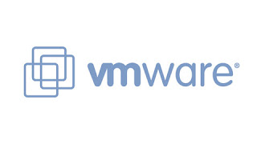

{.align-center}

Well, just upgraded my eee to fedora 15 and I have to say it's awesome! Much faster than the older version, I personally recommend you to make the jump.

But like always there were some problems, one of them was the hibernate feature ceasing to work, the other one was vmware console plugin just dying with no apparent reason and no log whatsoever (yes, I still use vmware server, my server processor does not comply with KVM virtualization...).

After a lot of google digging I've was able to find a quick and dirty fix, here is how it's done:

First of all create a folder named vmware-console and move yourself into it:

```bash
mkdir vmware-console 
cd vmware-console
```

Get from your vmware server the .xpi package with the console plugin:

```bash
wget --no-check-certificate  https://vmwareserver:8333/ui/plugin/vmware-vmrc-linux-x86.xpi
```

Or for the 64bit version: 

```bash
wget --no-check-certificate  https://vmwareserver:8333/ui/plugin/vmware-vmrc-linux-x64.xpi
```

Unzip the file:

```bash
unzip vmware-vmrc-linux-x86.xpi
```

Create a new file like this:

```bash
sudo gedit /usr/bin/vmware-vmrc
```

Paste the following magic code, and don't forget to change the `$PATH_TO_VMRC` variable so it points to the folder plugins you've extracted earlier:

```bash
#!/bin/bash

# Please define this variable with the path to the plugins folder
PATH_TO_VMRC="/home/user/vmware-console/plugins"

export VMWARE_USE_SHIPPED_GTK=yes
cd $PATH_TO_VMRC
./vmware-vmrc > /dev/null 2>&1 &
cd - > /dev/null 2>&1
```

Save and close the file and then change it to be executable:

```bash
sudo chmod +x /usr/bin/vmware-vmrc
```

Now try typing on the terminal

```bash
vmware-vmrc
```

Problem solved, you've vmware console back in business!

[Get it from GitHub](https://github.com/kintoandar/shell_scripts/blob/master/automation/vmware-vmrc.sh){.btn .btn--info}
